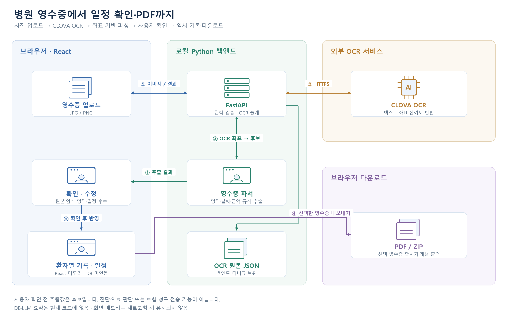

# 병원 영수증 OCR 기록·일정 관리 웹

**병원 영수증 사진을 OCR로 읽고, 추출된 정보·진료/검사 일정을 사용자가 확인·수정한 뒤 환자별로 확인하고 PDF로 내보내는 웹 과제입니다.**

> 문서 기준: 2026-10-22 제공된 로컬 코드. GitHub에는 문서·구성도를 우선 공유하며 실행 소스 동기화는 별도입니다. 현재 구현은 **React + FastAPI + CLOVA OCR**입니다. Java·Spring Boot·PostgreSQL·LLM 요약은 제공 코드에 없습니다.

## 대표 화면

개인정보를 제거한 테스트 영수증으로 촬영 후 추가할 예정입니다.

| 화면 | 보여줄 내용 |
|---|---|
| 문서 등록 | 환자 선택·영수증 이미지 업로드 |
| OCR 확인 | 원본 위 인식 영역·텍스트·신뢰도와 추출 후보 확인 |
| 기록·일정 | 사용자 확인 후 환자별 문서·진료/검사 일정 조회 |
| 보험 청구 준비 | 선택 영수증 PDF 합치기·개별 PDF ZIP 다운로드 |

## 프로젝트 개요

영수증에 흩어진 진료비·결제 정보·다음 진료/검사 일정을 직접 다시 입력하는 흐름을 줄이는 과제입니다. OCR 결과를 곧바로 확정하지 않고 **추출 후보 → 원본 확인·수정 → 반영**으로 구분합니다.

| 항목 | 내용 |
|---|---|
| 개발 기간 | 2주 — 사용자 확인 |
| 형태 | 개인 웹 과제 — 사용자 확인 |
| 구현 범위 | React 화면, Python OCR 중계·영수증 파서, 사용자 검수, 일정·PDF 출력 |
| 현재 저장 | React 메모리 상태 / 백엔드 OCR 디버그 JSON. DB 영구 저장 미구현 |

### 개발 환경

| 항목 | 내용 |
|---|---|
| 운영체제 | Windows |
| 프런트엔드 | Node.js v24.19.0으로 빌드 확인 / Vite 개발 서버 |
| 백엔드 | 로컬 `.venv` 설정 Python 3.13.9 |
| API | FastAPI, 기본 실행 안내 `127.0.0.1:8000` |
| OCR | CLOVA OCR V2 외부 HTTPS API |
| 저장 방식 | React `useState` 임시 보관. 새로고침 시 화면 데이터가 유지되지 않음 |

### 개발 도구

| 구분 | 도구 | 용도 |
|---|---|---|
| 프런트 패키지·빌드 | npm, Vite | 의존성 설치·개발 서버·정적 빌드 |
| 백엔드 실행 | venv, pip, Uvicorn | Python 격리 환경·ASGI 서버 |
| 문서 보조 | Codex | 코드 분석·구성도·문서 작성 |
| 저장소 | GitHub | 프로젝트 문서 공유 |
| IDE | 미확인 | 확인 전 특정 제품을 기재하지 않음 |

### 라이브러리·프레임워크

| 구분 | 이름 | 버전·범위 | 용도 |
|---|---|---|---|
| UI | React / React DOM | package.json `^19.2.8` | 환자·문서·일정과 검수 화면 |
| 프런트 빌드 | Vite | 선언 `^8.3.0`, 이번 빌드 8.3.4 | 개발 서버·프로덕션 번들 |
| PDF | jsPDF | `^4.2.1` | 선택 영수증 이미지를 A4 PDF로 변환 |
| 압축 | JSZip | `^3.10.2` | 개별 PDF 묶음 ZIP 생성 |
| API | FastAPI / Uvicorn | 기존 환경 0.143.0 / 0.54.0 | OCR 요청·재분석 API |
| 입력 모델 | Pydantic | 기존 환경 2.14.1 | 요청 데이터 형식·크기 검증 |
| 외부 호출 | Requests | 기존 환경 2.34.2 | CLOVA OCR HTTPS 요청 |
| 환경 설정 | python-dotenv | 기존 환경 1.2.4 | 백엔드 OCR URL·Secret 로딩 |
| 파서·화면 | Python re·datetime / SVG | 표준 기능 | 좌표 기반 필드·일정 추출, OCR 영역 표시 |

프런트는 선언된 범위와 실제 빌드 버전을 구분했습니다. 백엔드는 기존 환경 메타데이터 확인값이며 배포 잠금 파일이 아닙니다. CLOVA는 외부 OCR 서비스로, 자체 학습 모델이나 LLM 요약을 구현했다는 뜻이 아닙니다.

## 전체 시스템 구성도



[SVG 원본](docs/images/system-architecture.svg) · [이미지 생성 소스](docs/diagrams/build_architecture.py)

**React 업로드 → FastAPI 입력 검증 → CLOVA OCR → 좌표 기반 규칙 파서 → 사용자 확인·수정 → React 기록·일정 / PDF 다운로드** 흐름입니다. OCR 원본 JSON은 백엔드 디버그용이며 환자 기록의 DB 저장소가 아닙니다.

## 핵심 기능

### 문서 업로드와 OCR 중계

- JPG·PNG 이미지와 요청 크기를 확인하고 실제 파일 시그니처도 검증합니다. 이미지 바이트 기준 10MB 상한입니다.
- Secret은 백엔드 `.env`에서 읽고 React에 넣지 않습니다.
- `POST /api/ocr`에서 OCR 결과·좌표·신뢰도와 추출 후보를 반환합니다. 타임아웃·연결 실패·잘못된 응답을 구분합니다.
- `POST /api/ocr/parse`는 이미 받은 OCR JSON을 재분석합니다. CLOVA를 재호출하지 않습니다.

### 원본을 보며 검수하는 영수증 파싱

- 토큰 좌표로 기본 정보·항목별 진료비·금액/결제·진료/검사 일정 영역을 해석합니다.
- SVG 다각형으로 인식 영역을 표시하고 선택한 텍스트·신뢰도를 확인합니다.
- 금액·날짜·시간과 원본 필드 인덱스를 연결하고 확정하지 못한 후보·경고를 보존합니다.
- 파서는 **특정 서울대 영수증 배치용 초기 규칙**입니다. 모든 병원 양식 지원이나 추출 정확도를 보장하지 않습니다.

### 확인된 일정과 환자별 문서

- 환자·문서·일정을 React 상태로 관리하고 사용자 확인 후 일정을 반영합니다.
- 문서 삭제 시 관련 기록도 관리합니다. 현재는 DB나 localStorage 영구 저장 기능이 아닙니다.
- OCR 원본 JSON은 `backend/ocr_results/`에 디버그 저장될 수 있으며 저장 실패 상태도 응답합니다. 실제 의료 자료는 저장소에 올리지 않습니다.

### 보험 청구용 파일 준비

- 영수증을 선택하고 날짜 순으로 하나의 PDF로 합치거나 개별 PDF를 ZIP으로 받습니다.
- 브라우저에서 파일을 생성합니다. 보험사로 청구를 전송하거나 자격·지급 여부를 판단하지 않습니다.

## 실행 방법

아래는 제공된 로컬 소스 기준입니다. GitHub의 문서만으로 실행되는 배포본은 아닙니다.

### 백엔드

기존 Python 환경을 쓰거나 필요한 의존성을 별도 준비합니다. 백엔드 requirements 파일은 제공 자료에 없습니다. 아래 패키지는 현재 import·실행 구조 기준이며 이번에 설치하거나 변경하지 않았습니다.

```powershell
cd backend
python -m pip install fastapi uvicorn requests python-dotenv pydantic
python -m uvicorn main:app --host 127.0.0.1 --port 8000
```

`backend/.env`에는 `CLOVA_OCR_URL`, `CLOVA_OCR_SECRET`이 필요합니다. 실제 값은 공개하지 않습니다. OCR 실행은 외부 서비스 호출과 이미지 전송이 발생합니다.

### 프런트엔드

다른 터미널에서 프로젝트 루트로 이동합니다.

```powershell
npm ci
npm run dev -- --port 5173
```

브라우저에서 Vite가 안내하는 주소를 엽니다. 현재 프런트 API 주소는 `127.0.0.1:8000`으로 고정돼 있고 CORS는 로컬 5173/5174를 허용합니다. 다른 PC나 배포 환경에서 그대로 동작한다고 가정하지 않습니다.

## 검증 결과

| 항목 | 2026-10-22 확인 |
|---|---|
| 프런트 빌드 | `npm run build` 통과, Vite 8.3.4 / Node v24.19.0 |
| 빌드 제한 | 500kB 초과 청크 경고 관찰. 실패가 아닌 번들 크기 경고로 기록 |
| Python | 백엔드 2개 소스 AST 구문 검사 통과 |
| 순수 파서 | 합성 입력 2개: 빈 OCR 입력의 검수 경고·후보 없음, 쉼표 금액 변환 통과 |
| 미실행 | CLOVA 실제 호출, 실제 의료 JSON 분석, API 전체 실행, 화면 상호작용·PDF 다운로드 시연, 정확도 측정 |

실제 환자 파일·OCR 원본 JSON은 이번 분석에서 읽지 않았습니다. 구문·빌드 검증과 실제 OCR 인식·업무 적합성은 구분합니다.

## 상세 문서

- [프로젝트 분석·코드 근거](docs/project-summary.md)
- [개발 과정](docs/development-history.md)
- [설계 결정](docs/decisions.md)
- [트러블슈팅·제한 기록](docs/troubleshooting.md)
- [검증 기록](docs/validation.md)
- [기존 안내 보관](docs/history/README_TEMPLATE.md)

## 문제 해결 경험·배운 점

### OCR 텍스트를 원본 위치와 함께 해석

날짜·금액을 단순 문자열로만 추출하면 서로 다른 영역의 값이 섞일 수 있습니다. 현재 코드는 제목 위치·토큰 좌표·행 그룹과 원본 필드 인덱스를 활용하며, 결정하지 못한 항목은 경고와 함께 남깁니다.

**배운 점:** OCR의 텍스트와 화면 위치를 함께 다뤄야 구조화 결과를 검수할 수 있습니다. 특정 영수증 배치 규칙을 일반적인 병원 문서 인식 성능으로 확대하면 안 됩니다.

### 추출 결과와 사용자 확정을 분리

파서 결과에는 검수 필요 상태를 남기고, React는 사용자가 확인한 일정만 반영합니다. 이미 받은 OCR 결과의 재분석은 외부 API를 다시 호출하지 않습니다.

**배운 점:** 자동 추출을 최종 사실로 취급하지 않고 원본·후보·확정 상태를 구분하는 것이 중요합니다. 과거 실패 횟수·정확도·비용 절감 수치는 확인하지 않아 기재하지 않았습니다.

### 실제 구현과 소개 문서의 차이 정리

기존 GitHub 소개는 Spring Boot·PostgreSQL·LLM 요약을 제안했지만, 제공된 구현은 FastAPI·규칙 파서·React 임시 상태였습니다.

**배운 점:** 계획한 기술과 구현한 기술을 구분하고 현재 저장 범위를 정확히 설명해야 합니다. ‘DB 저장 완료’나 ‘AI 요약 구현’으로 표현하지 않습니다.
