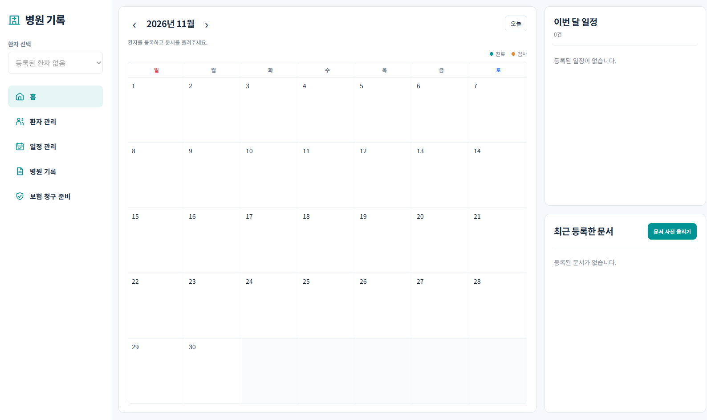
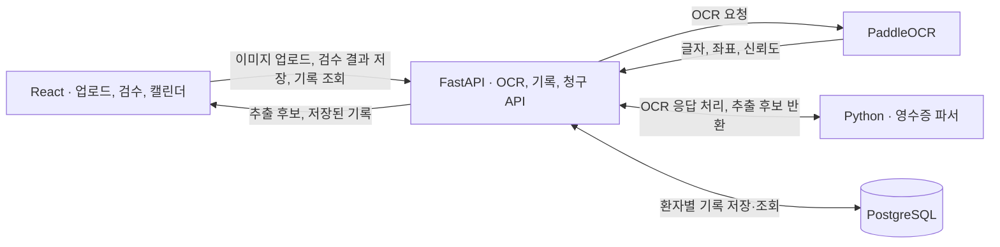

<h1 align="center">병원 영수증 OCR 기록·일정 관리 웹</h1>

<p align="center">병원 영수증에서 진료·검사 일정을 찾아, 원본을 보며 확인한 뒤 환자별 캘린더에 기록하는 웹 서비스입니다.</p>

<p align="center"><strong>개인 웹 프로젝트</strong></p>

<p align="center">
  <code>React + Vite</code> · <code>FastAPI</code> · <code>PaddleOCR</code> · <code>PostgreSQL</code>
</p>

<p align="center">
  
</p>

## 목차

1. [프로젝트 개요](#프로젝트-개요)
2. [기술 스택](#기술-스택)
3. [폴더 구조](#폴더-구조)
4. [설치 및 실행](#설치-및-실행)
5. [핵심 구현](#핵심-구현)
6. [검증 및 관련 문서](#검증-및-관련-문서)

## 프로젝트 개요

영수증에 적힌 다음 진료·검사 일정을 캘린더에 옮기려면 날짜와 시간을 다시 찾아 입력해야 합니다. 영수증에 접수일이나 결제일도 함께 표시될 수 있어, 어떤 날짜가 예약 일정인지 구분하는 과정이 필요합니다.

| 구분 | 내용 |
| --- | --- |
| 프로젝트 형태 | 개인 웹 과제 |
| MVP | 환자 선택 → 영수증 업로드 → 일정 후보 확인·수정 → 캘린더에서 조회 |
| 추가 기능 | 선택한 영수증을 보험 청구용 PDF·ZIP으로 생성하고, 환자별로 보관·재다운로드·사용 완료 표시 |

[프로젝트 상세 개요](docs/getting-started/project-overview.md) · [개발 과정](docs/development/development-timeline.md)

## 기술 스택

| 구분 | 기술 | 사용한 곳 |
| --- | --- | --- |
| 프런트엔드 | React, Vite | 환자 관리, OCR 검수, 캘린더, 보험 청구 화면 |
| 백엔드 | Python, FastAPI, Uvicorn | 이미지 입력 검증, OCR 호출·재분석, 기록·청구 API |
| OCR·파싱 | PaddleOCR PP-OCRv5, Python | OCR 응답의 글자와 좌표를 받아 영수증 항목과 일정 후보 추출 |
| 데이터베이스 | PostgreSQL, Psycopg | 환자, 원본 이미지와 문서, 확정 일정, 청구용 파일 저장 |
| 파일 생성 | jsPDF, JSZip | 영수증을 PDF로 변환하고 개별 PDF를 ZIP으로 묶기 |

### 서비스 구성



[PostgreSQL 테이블과 저장 API](docs/architecture/postgresql-schema-and-api.md)

## 폴더 구조

```text
├── frontend/                           # React 화면과 FastAPI 요청
│   └── src/
│       ├── HospitalRecordsApp.jsx       # 앱 화면과 상태 연결
│       ├── screens/                     # 캘린더, 환자, 일정, 병원 기록, 보험 청구 화면
│       └── api/                         # 백엔드 API 호출
├── backend/                            # FastAPI, OCR 처리, PostgreSQL 연동
│   ├── main.py                          # OCR·기록·청구 라우터 연결
│   ├── init_db.py                       # DB와 테이블 준비
│   ├── ocr/
│   │   ├── ocr_api.py               # OCR 호출과 결과 재분석 API
│   │   └── snuh_receipt_parser.py         # 좌표 기반 영수증 항목·일정 추출
│   ├── database/                        # 연결 설정, 초기화 로직, 스키마 SQL
│   ├── patient_document_records_api.py  # 환자·문서·일정 저장과 조회
│   └── insurance_claim_files_api.py    # 청구용 파일 보관과 재다운로드
├── docs/                               # 실행 안내, 설계, 개발·검증 기록
└── ocr-evaluation/                     # 일정 추출 평가 도구와 정답표 양식
```

[전체 폴더 안내](docs/getting-started/project-folder-map.md) · [파일별 코드 안내](docs/development/source-code-guide.md)

## 설치 및 실행

### Docker Compose로 실행

Docker Desktop의 Linux 컨테이너 엔진을 시작하고 저장소 루트에서 실행합니다.

```powershell
Copy-Item .env.example .env
```

루트 `.env`의 `DB_PASSWORD`를 설정한 뒤 다음 명령을 실행합니다.

```powershell
docker compose up --build -d --wait
```

기본 접속 주소는 [http://localhost:8080/](http://localhost:8080/)입니다. Nginx가 같은 주소의 `/api/` 요청을 `api:8000`에 전달하며, API는 `db:5432`에 접속합니다. DB가 준비되면 백엔드가 기존 스키마로 테이블을 초기화합니다.

- 접속 포트는 `WEB_PORT`, 바인딩 IP는 `WEB_BIND_IP`에서 변경합니다. 저장 후 `docker compose up -d --wait`를 실행하면 됩니다.
- 다른 PC의 브라우저에서 접속하려면 `WEB_BIND_IP=0.0.0.0`으로 설정하고 Docker를 실행하는 PC의 IP와 포트를 사용합니다. 방화벽에서 연결을 허용해야 할 수 있습니다. 이 구성은 로컬 시연용이며 LAN 공유에는 체험용 데이터만 사용합니다.
- DB 기록과 OCR 모델은 각각 Docker 볼륨에 보관됩니다. 첫 OCR 요청에는 모델 다운로드가 필요합니다. `docker compose down`으로 종료해도 볼륨은 남으며, `docker compose down -v`를 실행하면 두 볼륨이 삭제됩니다.
- 다른 PC에서 처음 실행하면 빈 DB가 생성됩니다. 기존 기록까지 옮기려면 PostgreSQL 백업을 복원합니다. 초기화 이후에는 `.env` 값과 PostgreSQL 계정의 비밀번호를 함께 변경해야 합니다.

### Docker 없이 Windows에서 실행

#### 실행 환경

| 항목 | 준비 사항 |
| --- | --- |
| 운영체제·터미널 | Windows, PowerShell |
| 프런트엔드 | Node.js 24.x, npm |
| 백엔드 | Python 3.12.x, 프로젝트용 가상환경 `.venv` |
| 데이터베이스 | PostgreSQL 18.x 서버 실행, DB 생성 권한이 있는 계정 |
| 실제 OCR 호출 | PaddleOCR 모델 다운로드를 위한 초기 외부 연결 |

#### 1. 저장소 복제 및 의존성 설치

```powershell
git clone https://github.com/rbgus4560/hospital-record-management-service.git
cd hospital-record-management-service

npm.cmd --prefix frontend ci
py -3.12 -m venv .venv
.\.venv\Scripts\python.exe -m pip install -r backend\requirements-paddle.txt
```

`py` 명령이 없다면 Python 3.12의 실행 파일로 `-m venv .venv`를 실행합니다.

#### 2. 환경변수 설정과 DB 초기화

```powershell
if (-not (Test-Path backend\.env)) {
    Copy-Item backend\.env.example backend\.env
}
```

[설정 예시](backend/.env.example)를 참고해 `backend/.env`를 편집합니다.

- `DB_HOST`, `DB_PORT`, `DB_NAME`, `DB_USER`, `DB_PASSWORD`를 현재 PC의 PostgreSQL 설정에 맞춥니다.
- 모델은 첫 OCR 요청에서 내려받고 이후 같은 서버 프로세스에서 재사용합니다. Windows에서는 모델을 `%LOCALAPPDATA%\HospitalRecordOCR`에 저장합니다. 경로에 한글이 있으면 `PADDLE_PDX_CACHE_HOME`에 쓰기 가능한 영문 경로를 지정합니다.
- 프런트엔드는 기본 API 주소 `http://127.0.0.1:8000`을 사용합니다. 주소를 바꾸는 경우에만 `frontend/.env.local`의 `VITE_API_BASE_URL`을 설정합니다. 비밀키와 DB 비밀번호는 Git에서 제외된 백엔드 `.env`에 둡니다.

PostgreSQL 서비스가 실행 중인 상태에서 프로젝트 루트에서 초기화합니다.

```powershell
.\.venv\Scripts\python.exe backend\init_db.py
```

#### 3. 백엔드와 프런트엔드 실행

백엔드용 터미널에서 실행합니다.

```powershell
cd backend
..\.venv\Scripts\python.exe -m uvicorn main:app --host 127.0.0.1 --port 8000
```

별도 터미널을 열고 프로젝트 루트에서 프런트엔드를 실행합니다.

```powershell
npm.cmd --prefix frontend run dev -- --host 127.0.0.1 --port 5173 --strictPort
```

| 확인 항목 | 주소 |
| --- | --- |
| 웹 화면 | [http://127.0.0.1:5173/](http://127.0.0.1:5173/) |
| FastAPI 문서 | [http://127.0.0.1:8000/docs](http://127.0.0.1:8000/docs) |
| 기록 조회 | `GET http://127.0.0.1:8000/api/state` → HTTP 200 |

기록 조회가 HTTP 503이면 PostgreSQL 서비스, `backend/.env`의 DB 설정, 초기화 여부를 확인합니다. 설정을 바꾼 뒤에는 백엔드를 재시작합니다. 현재 실행 안내는 로컬 시연 기준입니다. [학교 PC 설치·실행 및 DB 이전 안내](docs/getting-started/run-on-school-pc.md)

## 핵심 구현

### OCR 좌표로 예약일과 시간 찾기

영수증에 날짜가 여러 개 있으므로, 파서는 **날짜 형식과 영수증 안의 위치**를 함께 사용합니다. 서울대병원 영수증의 특정 배치를 기준으로 다음 순서로 처리합니다.

1. **이미지 검증과 OCR 호출**

   FastAPI가 JPG·PNG 형식과 요청 크기를 확인합니다. PaddleOCR로 텍스트, 좌표, 신뢰도를 얻고 기존 API 형식으로 변환합니다. 원본 OCR 결과의 `inference_ms`는 모델 로딩과 요청 대기 시간을 제외한 추론 시간입니다.
2. **진료·검사 영역 구분**

   좌표에서 각 글자 영역의 위치를 계산하고, `진료일`과 `검사일` 제목 사이의 중점을 기준으로 두 열을 나눕니다.
3. **일정 후보 추출**

   각 제목 아래에서 날짜를 찾고, 같은 열의 다음 날짜가 나오기 전까지 관련 텍스트를 묶어 시간과 세부 정보를 추출합니다. 후보에 원본 필드 인덱스를 남겨 추출 근거를 확인할 수 있게 합니다.
4. **원본 검수와 확정 일정 저장**

   검수 화면에서 원본 이미지 위에 인식 영역을 표시합니다. 사용자가 값을 확인하거나 수정해 확정하면, 문서 갱신과 환자별 일정 반영을 같은 DB 트랜잭션으로 처리합니다. 캘린더에서 저장된 일정을 다시 조회할 수 있습니다.

[OCR 호출](backend/ocr/ocr_api.py) · [일정 파서](backend/ocr/snuh_receipt_parser.py#L16) · [OCR 원본 뷰어](frontend/src/screens/hospital-records/OcrImageViewer.jsx) · [기록 저장 API](backend/patient_document_records_api.py)

## 검증 및 관련 문서

- **로컬 실행** — Windows에서 새로 복제한 뒤 프런트엔드와 API 문서에 접속했고, PostgreSQL 초기화 후 기록 조회 HTTP 200을 확인했습니다.
- **DB 통합 테스트** — 검증 기록에 실제 PostgreSQL의 임시 스키마에서 CRUD, 재조회, 오래된 수정 요청 거부, 문서·일정 롤백을 포함한 테스트 3건의 통과가 남아 있습니다.
- **시연 범위** — 기존 검증 범위는 저장소 문서에 기록했습니다. 최신 화면에서 영수증 업로드부터 일정 반영까지의 전체 시연은 이번 로컬 실행 점검 범위 밖입니다.

[검증 기록](docs/development/test-and-validation-log.md) · [트러블슈팅](docs/development/troubleshooting-log.md) · [설계 결정](docs/architecture/design-decisions.md) · [전체 문서](docs/README.md)

### 진료·검사 완료 처리
진료·검사 화면은 기본으로 예정 항목만 표시합니다. 완료 버튼은 상태를 DB에 저장하며 완료 필터에서 이력 조회와 예정 복원이 가능합니다. 검색·날짜·종류 필터를 함께 적용합니다.

다른 PC에서 최신 코드를 받은 뒤 기존 설정을 유지하고 backend/init_db.py를 실행한 후 백엔드를 재시작합니다. 기존 기록을 보존하며 완료 컬럼을 추가하고 기존 일정은 예정으로 유지합니다. Git에는 코드가 반영되며 실제 기록과 완료 상태는 각 PC의 DB에 저장됩니다.
