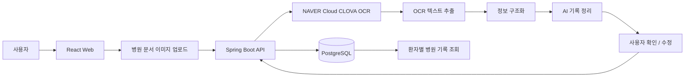

#  병원 기록 관리 서비스

> 병원 문서를 OCR로 인식하고, 추출된 정보를 AI로 정리하여 환자별 기록으로 저장·조회하는 웹 서비스

---

##  프로젝트 목적

처방전과 같은 병원 문서를 직접 확인하며 필요한 정보를 다시 입력해야 하는 불편을 줄이기 위해,
문서 이미지를 업로드하면 OCR을 통해 내용을 추출하고 웹에서 확인·수정할 수 있는 서비스를 구현하는 것이 목적입니다.

추출된 텍스트는 단순히 화면에 표시하는 데 그치지 않고,
**AI를 활용해 사용자가 보기 쉬운 형태로 정리한 뒤 환자별 병원 기록으로 저장·조회**할 수 있도록 구성합니다.

AI는 의료적 진단이나 판단을 수행하지 않고,
OCR로 추출한 문서 내용을 정리·구조화하는 용도로 사용합니다.

---

##  기술 스택

| 구분 | 기술 | 사용 목적 |
|---|---|---|
| Frontend | React | 문서 업로드, OCR 결과 확인·수정, 기록 조회 화면 구현 |
| Backend | Java / Spring Boot | REST API, 비즈니스 로직, OCR·AI API 연동 |
| OCR | NAVER Cloud CLOVA OCR | 병원 문서 이미지에서 텍스트 추출 |
| AI | LLM API | OCR 결과를 읽기 쉬운 기록 형태로 정리 |
| Database | PostgreSQL | 환자 정보, 문서 정보, 정리된 병원 기록 저장 |
| 통신 | REST API | React ↔ Spring Boot 데이터 통신 |

> 사용할 LLM API는 구현 단계에서 최종 확정합니다.

---

##  시스템 구성

### 구성 흐름

**사용자 → React → Spring Boot → CLOVA OCR → 정보 구조화 → AI 기록 정리 → 사용자 확인·수정 → PostgreSQL → 기록 조회**

- **React**: 병원 문서 업로드, OCR 결과 확인·수정, 환자별 기록 조회
- **Spring Boot**: Frontend 요청 처리, CLOVA OCR 및 AI API 연동, 기록 저장 로직 처리
- **CLOVA OCR**: 업로드한 병원 문서 이미지에서 텍스트 추출
- **AI**: OCR 결과를 사용자가 보기 쉬운 형태로 정리·구조화
- **PostgreSQL**: 환자 정보와 병원 기록 저장

---
